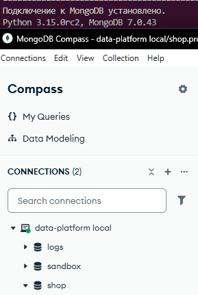
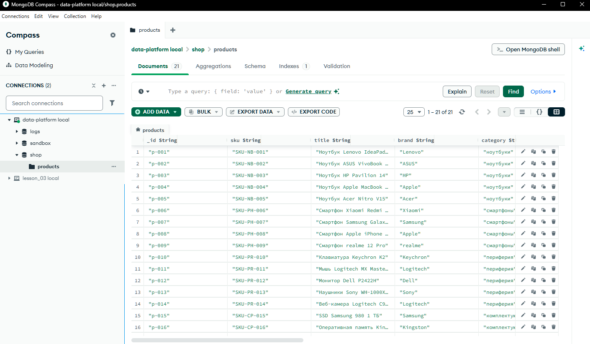
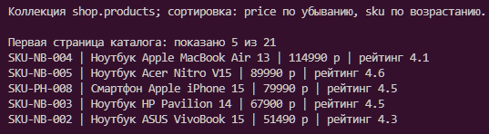
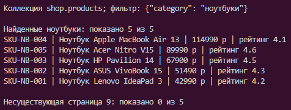
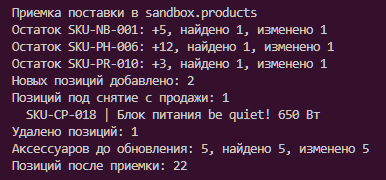
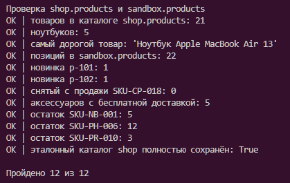

# Домашнее задание № 3 · Каталог товаров

**ФИО:** Колобов Евгений Денисович

**Группа:** 9РПО1

**Дата:** 31.10.2026

### Среда выполнения

- ОС: Windows.
- Язык и драйвер: Python 3.15.0rc2, PyMongo 4.18.2.
- Сервер: MongoDB 7.0.43 в Docker, образ `mongo:7`.
- Вариант выполнения: программа на Python, просмотр данных в Compass и проверка через запросы к MongoDB в терминале.
- Базы: `shop` — исходный каталог, `sandbox` — изменения.
- Коллекция: `products`.
- Команда запуска из корня репозитория: `rtk proxy python -X utf8 lesson_03/solution.py`.

### Результаты

Загрузил 21 товар в `shop.products` и такую же исходную коллекцию в `sandbox.products`. В каталоге сделал сортировку по цене и вывод по страницам: первая страница показывает 5 из 21 товара. Самый дорогой товар -
ноутбук Apple MacBook Air 13, цена 114990 ₽.

По категории «ноутбуки» нашлось 5 товаров. На несуществующей странице 9 список пустой, но общее число подходящих товаров осталось 5.

В песочнице принял поставку: увеличил остатки трёх артикулов на 5, 12 и 3, добавил подставку Ugreen и док-станцию Baseus, удалил снятый с продажи `SKU-CP-018`. Для 5 аксессуаров включил бесплатную доставку. После операций осталось 22 товара. Проверка состояния базы прошла **12 из 12**, исходный каталог `shop.products` не изменился.

### Скриншоты

Подключение и загруженные товары показаны в Compass, каталог, поиск,
приёмка и итоговая проверка — в терминале.

1. Подключение: 
2. Загрузка товаров: 
3. Каталог: 
4. Поиск: 
5. Приёмка: 
6. Проверка в базе: 

### Ответы на вопросы

**1. Какие поля есть у товара и почему цену и количество нельзя хранить строками?**

Есть _id, sku, title, brand, category, price, specs, stock, rating, reviews и дата added; после приёмки появляются
qty_total и free_shipping.
У строк другой порядок сравнения: например, строка "100" окажется перед "20", $inc не сможет прибавить количество к строковому полю

**2. Чем обычное чтение отличается от поиска по условию?**

Чтение без фильтра возвращает все документы коллекции. Условие оставляет только ноутбуки

**3. Как проверено, что изменились данные в MongoDB, а не только вывод программы?**

После приёмки выполнил отдельные запросы к sandbox.products. Проверил наличие новых товаров, отсутствие снятого с продажи артикула, остатки 5/12/3 и бесплатную доставку у 5 аксессуаров

### Вывод

Сделал каталог с фильтром, сортировкой и страницами, затем выполнил вставку, обновление и удаление товаров в песочнице. Программа подключается к MongoDB, результаты подтверждены запросами к базе
