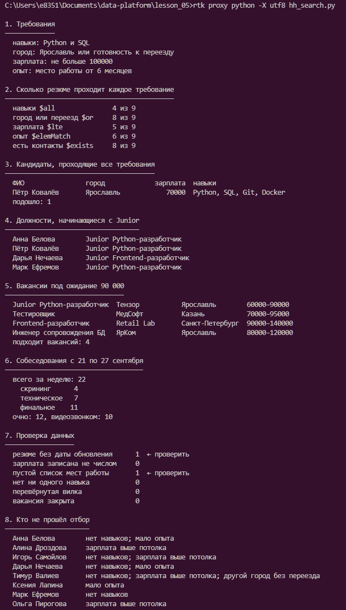
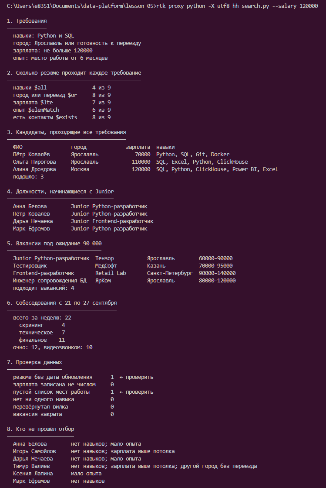
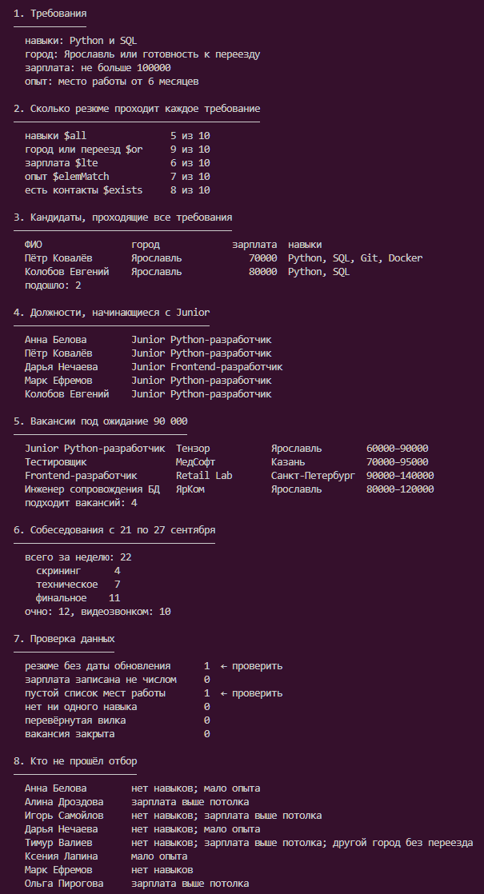

# Домашнее задание № 5 · Подбор кандидатов

Колобов Евгений Денисович · 9РПО1 · 31.10.2026

## Операторы

| Раздел | Чем сделан |
|---|---|
| 1. Требования | Переменные и вывод Python |
| 2. Каждое требование | `$all`, `$or`, `$lte`, `$elemMatch` с `$gte`, `$exists`, `count_documents` |
| 3. Все требования | Неявное И полей фильтра, `$or`, `$all`, `$lte`, `$elemMatch`, `find`, `sort` |
| 4. Поиск Junior | `$regex: "^junior"`, `$options: "i"` |
| 5. Вакансии | `$lte` и `$gte` по `salary.from` и `salary.to` |
| 6. Собеседования | `$gte` и `$lt` по дате, равенство по этапу и формату |
| 7. Проверка данных | `$exists`, `$not` с `$type`, `$size`, `$expr` с `$gt`, `$ne` |
| 8. Причины отказа | Сравнения Python, множества и `any` |

## Результаты

Исходные требования: Python и SQL, Ярославль или переезд, зарплата до 100000 ₽, одно место работы от 6 месяцев.

| Что изменено | Подошло | Кто |
|---|---|---|
| Ничего | 1 | Пётр Ковалёв |
| Навыки: только Python | 2 | Пётр Ковалёв, Марк Ефремов |
| Город: Москва | 0 | Никто |
| Потолок зарплаты: 120000 ₽ | 3 | Пётр Ковалёв, Ольга Пирогова, Алина Дроздова |
| Срок работы: 4 месяца | 2 | Пётр Ковалёв, Ксения Лапина |
| Добавлено своё резюме | 2 | Пётр Ковалёв, Колобов Евгений |

Своё учебное резюме добавлено через Compass: Python и SQL, Ярославль, зарплата 80000 ₽, опыт 6 месяцев.

## Скриншоты

## Вывод

Нужно поднять потолок зарплаты до 120000 ₽. В разделе 2 зарплату проходят 5 из 9, навыки — 4, город — 8, опыт — 6. Раздел 8 показывает, что Дроздова и Пирогова не проходят только по зарплате. После изменения потолка подходят трое, остальные требования сохранены.
